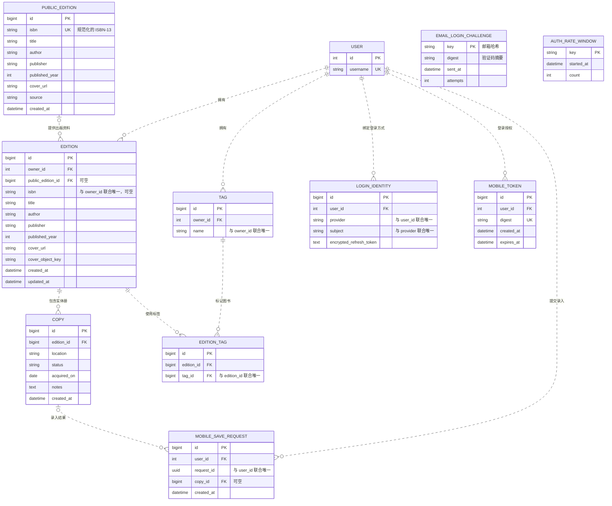

# 数据库 ER 图

图中使用 Django 模型名。实体和关系以 `catalog/models.py` 和数据库迁移为准。新增字段或改变关系时，在同一个改动中更新这张图。

`PUBLIC_EDITION` 保存外部来源提供的出版资料。网页版和 iOS 扫码在当前书库没有可用资料时，按 ISBN 查询这张表，再尝试外部来源。只收录有书名和来源的 ISBN 图书。无 ISBN 图书和 `977` 期刊条码继续沿用现有录入方式。

`EDITION` 保留账号内使用的资料和用户修改。扫码保存时把补全的书目填进个人记录，现有 iOS 同步、封面处理、排序和导出继续使用这份数据。外键记录对应的公共书目，个人版本的字段修改只影响该账号。删除公共书目会解除关联，个人藏书仍可使用。

迁移 `0010` 添加公共表和可空外键。已有账号的书目、标签等内容仍留在原书库。公共表随查询积累，可以在生产环境迁移后按需执行 `python manage.py link_public_editions`，将已存在的同 ISBN 公共书目关联到旧记录。命令可以重复执行，只更新外键。
